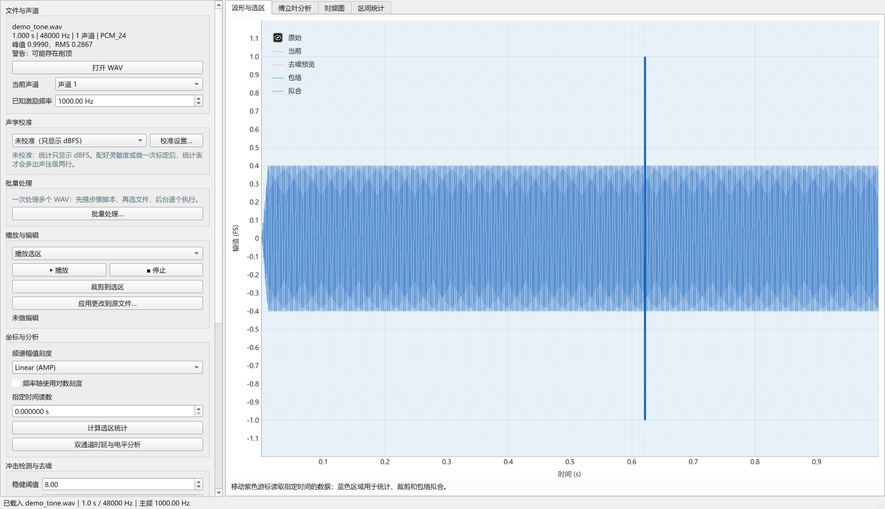
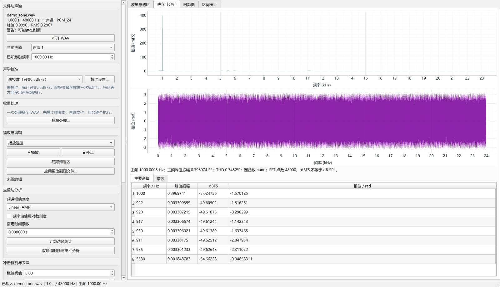

# WAV Analyzer

**English** · [简体中文](README.zh-CN.md)


A Windows desktop application for turning acoustic measurement recordings into numbers you can defend. Open a WAV, inspect the waveform, spectrum and spectrogram, strip out transient hits, fit an envelope, compute interval statistics, and export fixed-width TXT, CSV, 600 dpi figures or a standalone HTML report — or push hundreds of files through a reusable batch script. An optional LLM assistant can drive the same tools in natural language, and every change it proposes still needs your confirmation.

Waveform and selection editor / Fourier analysis:




**Why it exists.** Acoustic data processing is usually "copy numbers out of Excel, plot them in Origin". Conventions drift, transcription errors hide, and the number in the report stops matching the number in the tool. WAV Analyzer pins the window function, normalisation and statistical definitions in one place, so the on-screen readout, the batch output and the exported report all come from the same code path.

---

## What it is good for

| Workload | What you get |
|---|---|
| Steady-state tone recordings (speaker, transducer, resonator characterisation) | RMS level, peak amplitude, crest factor, THD, harmonic table — measured over a selection you draw on the waveform |
| Sweeps and chirps | Spectrogram with linear or log frequency axis; per-segment interval statistics |
| Impulse responses and knock tests | Envelope fit (constant / linear / exponential) with equation, R² and RMSE |
| Recordings contaminated by handling noise, clicks or clipping | Automatic transient detection, preview before commit, interpolation repair or exclusion |
| Level comparison between two takes (with / without a sample, near / far, before / after treatment) | Two-channel mode: cross-correlation delay, per-channel level, level difference |
| Dozens to hundreds of runs per session | Step-script batch pipeline with progress overlay, cancellable |
| Figures and tables for a paper or report | 600 dpi paper-size PNG, fixed-width TXT, tidy CSV, HTML report |

Nothing in the program is tied to a particular rig. If it is a WAV file with a signal in it, it loads.

---

## 1. Running it

### Option A — prebuilt binary (recommended)

Download `WAV_Analyzer_v1.5_win64.zip` from [Releases](../../releases), unpack it, and double-click `WAV Analyzer.exe`. Python is not required.

1. Unpack into its own folder, e.g. `WAV Analyzer`.
2. The first launch is slower than later ones — the one-file build unpacks its bundled components into a temp directory. That is expected.

> If Windows shows "Windows protected your PC", click **More info → Run anyway**. The binary is not code-signed; it is not malware. Scan it yourself if you like.

**Optional command line usage** — drag a WAV onto the exe, or:

```
"WAV Analyzer.exe" "D:\data\sample.wav"
```

The file loads on startup.

### Option B — from source

Python 3.11 or newer (developed and tested on 3.13).

```bash
git clone <this-repo-url> wav-analyzer
cd wav-analyzer

python -m venv .venv
# Windows
.venv\Scripts\activate
# macOS / Linux
source .venv/bin/activate

pip install -r requirements.txt
python run_app.py            # launch the GUI
```

On Windows you can also double-click `run_app.bat`; it prefers `py -3` and falls back to `python` on PATH.

---

## 2. Features

| Area | Capability |
|---|---|
| Import | Mono or stereo WAV, quality check on load (peak, RMS, clipping warning), source file opened read-only |
| Waveform | Trace, time cursor readout, blue selection, numeric time entry |
| Spectrum | Linear amplitude or dBFS, linear or log frequency axis, phase spectrum |
| Fourier analysis | Fundamental, peak amplitude, dominant spectral peaks, harmonics 1–8, THD |
| Spectrogram | STFT distribution, for spotting broadband transients |
| Transient repair | Detection with preview, discard preview, short-hit interpolation, long-hit exclusion, undo |
| Playback & edit | Play selection or whole file, pause, crop to selection, write back to source (with automatic backup) |
| Envelope | Hilbert envelope, constant / linear / exponential fit, equation, R², RMSE |
| Interval statistics | 21 quantities shown as name + value + definition, including RMS, peak, peak-to-peak, crest factor, RMS level, THD |
| Acoustic calibration | Convert dBFS to dB SPL from microphone sensitivity, preamp gain and ADC full-scale voltage, or from a known reference level; multiple profiles, carried into statistics and every export |
| Two-channel | Cross-correlation delay, per-channel level, level difference, AGC warning |
| AI assistant | DeepSeek / Moonshot / OpenAI presets or any OpenAI-compatible endpoint; whitelisted tool calls; user and assistant turns in distinct coloured bubbles; answers rendered as Markdown; repairs always need confirmation |
| Export | Processed WAV, fixed-width analysis TXT, image PNG (paper or screen layout), statistics CSV, standalone HTML report |
| Batch processing | Step script (repair / crop / envelope / statistics / five export types) applied to a multi-file selection, executed in the background behind a dimmed overlay with import and processing progress, cancellable |

---

## 3. Quick start

1. Launch and click **Open WAV**.
2. Drag the blue selection over the steady-state portion of the waveform.
3. Switch to the **Fourier analysis** tab for fundamental, spectral peaks and THD.
4. Switch to the **Spectrogram** tab and look for narrow vertical bands — those are transients.
5. Back on the waveform tab, click **Detect and preview**. The orange trace is the repaired version; **Discard preview** leaves your data untouched, **Apply preview** commits it.
6. Click **Compute interval statistics** for the full table (the third column defines each quantity). **Show envelope and fit selection** gives you the envelope equation.
7. Use the playback group to listen to the selection; **Crop to selection** when you only care about one part of the response.
8. Save results from the export panel: processed WAV, analysis TXT, PNG, CSV, HTML report. **Apply changes to source file…** is only for overwriting the original, and it writes a `.bak-<timestamp>.wav` next to it first.

Full walkthrough and algorithm details are in the bundled manual.

---

## 4. Exporting into a report

**Figures.** In the image export dialog pick *paper single column 3.5 × 2.45 in (600 dpi)* or *paper double column 7.0 × 2.6 in*. Paper layouts are generated at physical size, so dropping them into a two-column Word or LaTeX document needs no rescaling and the type size and line weights stay correct. Ticks point inward, all four spines are drawn, background is white, and the legend sits in a single row below the plot instead of on top of the curves. When single-column output has both envelope and fit enabled, the plot splits into two stacked panels automatically.

**Numbers.** *Export analysis TXT…* produces a plain-text report in seven sections (envelope, Fourier, interval statistics, two-channel, AI notes, repair log, raw coordinates); unchecked sections are skipped and the numbering closes up. The whole file is space-aligned with no tab characters, and every column except the last is ASCII-only, so it stays aligned in any monospace font. The header carries the MD5 of the source WAV, so you can prove which recording a given export came from.

The coordinate section is the longest. Before export choose *fixed points per second*, *decimate by stride*, or *all samples*; if you pick all samples and the output is projected above 5 million lines, the program asks once more.

Reading it back: `pandas.read_csv(path, sep=r"\s+", comment="#")`; Excel uses *Data → Text to Columns → Fixed width*; Origin uses space-delimited and skips `#` lines.

---

## 5. Batch processing

One session often produces dozens or hundreds of WAV files. **Batch processing…** is not a one-shot action but a reusable **step script**:

1. **+ Add step** and pick a function from the dropdown — everything the single-file UI can do is there (transient repair, crop, envelope fit, interval statistics, two-channel, export WAV / analysis TXT / PNG / statistics CSV / HTML report).
2. Configure each step's parameters on the right. Options that are meaningless for the current combination are greyed out (e.g. the merged-file name is irrelevant when exporting one TXT per file).
3. **Select files to process** and multi-select WAVs. This step only records paths — it does not read the files, so selecting hundreds is instant.
4. Set the output directory (blank = alongside the source files) and click **Start**.

Three details worth knowing:

- **Excitation frequency can come from the filename.** Set *known excitation frequency* to *frequency in filename* in the statistics step, and `run_1000Hz_r1.wav` yields 1000 Hz. A batch spanning several frequencies needs no per-file editing.
- **TXT and CSV both merge.** With *merge into one TXT*, each file's full report (with its own source name, path and MD5) is appended in processing order under a single file list header. Merged CSV puts one file per line, ready for Origin.
- **It will not freeze.** The main window dims and a card shows *Importing file (m/n): name* and *Processing file (m/n): name* above a total progress bar. **Cancel** stops after the file currently in flight, so you never get a half-written output.

Scripts save and load as JSON; the last used steps and output directory are remembered across sessions. Source files always stay read-only, and output only goes to the output directory.

---

## 6. Acoustic calibration

By default every amplitude the program shows is normalised to digital full scale (FS). dBFS is **not** sound pressure level, and the program never pretends otherwise — without a calibration it simply does not emit dB SPL.

Calibration is a single additive offset applied to the level axis:

```
K = 20 · log10( Vfs / (G_lin · S · 20 µPa) )
L_SPL = L_dBFS + K
```

where `S` is microphone sensitivity in V/Pa, `G_lin` the preamp gain as a linear factor, and `Vfs` the ADC full-scale voltage in Vrms. Example: 10 mV/Pa, 0 dB gain, 1 Vrms full scale gives `K = +133.98 dB`, so 94 dB SPL corresponds to −39.98 dBFS.

There are three entry modes in the calibration dialog:

- **Sensitivity + gain + full scale** — the formula above, for hardware you have a datasheet for.
- **Reference level (two-point)** — play a stable source, read the level on a sound level meter and the dBFS in the program, and `K = L_ref − L_dBFS`. This bypasses the two least trustworthy parameters entirely, so it is often the better route when the datasheet is missing or the ADC full scale is unknown.
- **Uncalibrated** — statistics stay in dBFS only.

Profiles are named and stored, and the currently selected one applies to batch runs as well. Because `K` cancels in any difference of two levels, a level-difference result does not depend on calibration accuracy; calibration matters for *absolute* levels and for comparing batches recorded at different gain settings.

**What it is not.** Calibration here is one constant offset. There is no frequency weighting (no dBA), no microphone frequency-response correction, and no validity for AGC-equipped hardware. If you need metrologically valid SPL, use a sound level meter with a current calibration certificate.

---

## 7. Notes and caveats

1. **Source WAVs are read-only by default.** All editing happens in memory; you must save to write a new file. Only *Apply changes to source file…* overwrites the original, and it backs up to `.bak-<timestamp>.wav` in the same folder first. After a write-back the undo stack is cleared — that backup is your only way back.
2. **Units.** dBFS is a level relative to digital full scale, not dB SPL. Statistics, CSV, TXT and the report only gain SPL fields once a calibration profile is active. **Recordings from AGC microphones or recordings that have clipped cannot be converted this way.**
3. **Statistical conventions.** The third table column defines every quantity and its dimension. The usual confusions: peak amplitude is `max|x|` (always positive), peak-to-peak is `max−min` (about twice as large for a symmetric signal), RMS includes any DC offset, and crest factor is ≈1.414 for a sine. CSV exports keep English key names so scripts stay stable.
4. **Repairs need review.** Automatic thresholds were validated on synthetic signals; on real data, preview first and confirm against the waveform and spectrogram. Long transients are excluded from statistics rather than replaced with invented signal.
5. **AGC warning.** If the microphone uses a module with automatic gain control (e.g. MAX9814), the gain tracks the sound pressure, so an amplitude ratio no longer reflects a true pressure ratio. Level-difference conclusions must then be backed by a sound level meter or a reliable amplitude calibration, and the report has to state whether AGC was active.
6. **AI safety.** The assistant can only call built-in whitelisted tools — never arbitrary code. Repairs require your confirmation and no dialog appears when nothing was detected. What is sent to the model is a numeric summary by default, not the full WAV. **The API key is stored in the Windows Credential Manager and WAV Analyzer never discloses it to anyone**: it goes into a request header only when talking to the Base URL you configured, and it never appears in exported TXT, CSV, images or reports.
7. **Long files and numerical conventions.** Recordings of 15 minutes / 40 million samples and up are processed in chunks with a progress overlay; the UI stays responsive. Conventions to keep in mind when reporting:
   - **RMS, peak, peak-to-peak, standard deviation and other energy statistics** always use every valid sample in the selection — no approximation.
   - **Fundamental and THD** are computed on a centred window of about 5.5 s (262,144 points) by default, giving ≈0.18 Hz resolution at 48 kHz, to avoid holding the UI for minutes on very long files. The Fourier tab states the actual time span and point count it used; for high-precision steady-state work, re-check with the full-length path.
   - **Waveform display, image export and spectrogram** are decimated for display only. Peaks and readouts are unchanged, and decimated data never enters any calculation.
   - **Cursor envelope readout** uses a centre-symmetric window, so there is no systematic bias on steady-state signals.
   - **Undo stack** keeps at most 4 levels, about 1.2 GB in total; older entries are dropped first.

---

## 8. Build, test, package

```bash
pip install -r requirements.txt

pytest -q                     # 141 tests
pytest tests/test_batch.py    # batch pipeline only
```

GUI tests need `QT_QPA_PLATFORM=offscreen` on machines without a display (Linux CI in particular):

```bash
QT_QPA_PLATFORM=offscreen pytest -q
```

Headless self-check after changing code — no clicking required:

```bash
# Windows
set WAV_ANALYZER_SELFTEST=demo\demo_tone.wav
python run_app.py
# result is written to demo/selftest_result.json
```

It walks load WAV → Fourier → statistics → paper-layout PNG → TXT export → batch pipeline → Markdown rendering → keyring, and prints `ok: true` when the core chain is intact.

Single-file executable:

```bash
pip install pyinstaller
pyinstaller --noconfirm --clean WAV_Analyzer.spec
# product: dist/WAV Analyzer.exe
```

`WAV_Analyzer.spec` explicitly collects PortAudio, libsndfile and the keyring Windows backend. Those three are the runtime dependencies most likely to be missed; without them you get `PortAudio library not found`, `cannot load library libsndfile`, and `NoKeyringError` respectively.

Documentation screenshots:

```bash
python docs/make_readme_shots.py    # main window
python docs/make_batch_shots.py     # batch dialog and progress overlay
python docs/make_ai_shots.py        # AI settings and chat
python demo/make_demo_tone.py       # synthetic demo recording (1 s / 1000 Hz + one transient)
```

Screenshot generation must run on a native Windows platform: under the offscreen platform the system fonts are unavailable and all Chinese text turns into boxes. Windows are moved off-screen and grabbed.

---

## 9. Project layout

```
run_app.py            entry point (also hosts the headless self-check branch)
WAV_Analyzer.spec     PyInstaller build config
requirements.txt      runtime and test dependencies

core/                 pure computation, no Qt dependency
  audio_io.py           WAV I/O and quality checks
  spectral.py           Fourier analysis, spectral peaks, harmonics, THD
  denoise.py            transient detection and repair
  editing.py            cropping, envelope fitting
  statistics.py         21 interval statistics
  calibration.py        dBFS to dB SPL conversion (sensitivity / gain / two-point)
  figure_export.py      image export (screen and paper layouts)
  txt_export.py         fixed-width TXT reports
  report.py             HTML reports
  batch.py              batch pipeline engine (step declaration + per-file execution)
app/                  desktop layer (PySide6)
  main_window.py        main window and interaction
  chat_view.py          AI conversation bubble view
  markdown_lite.py      Markdown to Qt rich text (safe subset only)
  batch_dialog.py       batch script editor
  batch_progress.py     batch progress overlay
  settings_dialog.py    model settings
  calibration_dialog.py acoustic calibration dialog
  workers.py            background threads
ai/                   AI assistant
  client.py             OpenAI-compatible client
  assistant.py          prompt and tool loop
  tools.py              whitelisted tools
tests/                automated tests (141)
docs/                 manual (LaTeX source + PDF) and screenshot scripts
demo/                 synthetic demo recording and screenshots; real measurement data is never committed
```

Everything under `core/` is importable without Qt, so the same functions work in a script or a notebook. That is also why on-screen readouts, batch output and exported reports agree: all three call the same function.

---

## 10. Troubleshooting

- **Double-click does nothing / blocked** — see the SmartScreen note in section 1, or right-click and run as administrator.
- **Chinese text shows as boxes** — install Microsoft YaHei (present by default on Windows 10/11).
- **UI greyed out with a spinner** — background computation in progress. Wait; do not click repeatedly.
- **Program exits immediately** — usually out of memory. Crop to the region of interest first, or close other memory-heavy applications.
- **Write-back is refused** — the file is held by a player, a cloud sync client or antivirus, or is read-only. Close the holder and retry.
- **No sound on playback** — no output device, system muted, or device in exclusive mode. The program resamples to the device rate and reports failure explicitly.
- **AI connection fails** — 401/403 usually means a bad key or no balance, 404 usually means the Base URL is missing `/v1` or the model name is wrong, 429 is rate limiting. Prefer the vendor presets: a preset only needs an API key.
- **AI request times out** — the default is 120 s, and reasoning models writing long answers can hit it. Raise the timeout to 300 s in model settings, or use a faster model.
- **Cannot open a WAV** — it must be a `.wav` with PCM encoding, mono or stereo; keep the path reasonably short and free of exotic characters.

A longer error table lives in the manual's troubleshooting chapter.

---

## 11. Requirements

- Windows 10 / 11, 64-bit
- 8 GB RAM recommended, more if you routinely open tens of millions of samples
- No network needed for any manual analysis feature; only the AI assistant requires a connection
- Playback needs a working output device; everything else works without one
- The Chinese UI relies on Microsoft YaHei, shipped with Windows 10/11

The program does not touch the registry or write to system directories. Settings live in the current user's application data directory; the API key lives in the Windows Credential Manager. Source WAVs are opened read-only.

---

## 12. License and contributing

Released under the **MIT License** — see [LICENSE](LICENSE). Use it, modify it, redistribute it, commercially or otherwise; keep the copyright and licence notice.

**Contributions that help:**

- Tell us a signal class (sweep, impulse response, white-noise excitation, …) is handled with the wrong convention, and attach a small reproducible WAV.
- For bugs, include program version, OS, reproduction steps and self-check output. "It won't open" alone is not actionable.
- For a new statistic or export format, open an issue to agree on the definition first — the whole point is that one quantity has one definition.

**Out of scope:** using this as a sound level meter or a sound power analyser. As described in section 6, calibration is a single offset — no frequency weighting, no microphone response correction, no validity for AGC hardware.

---

*Built to make one lab's measurement pipeline reproducible, and written so any acoustic recording workflow can use it. Pull requests welcome.*
