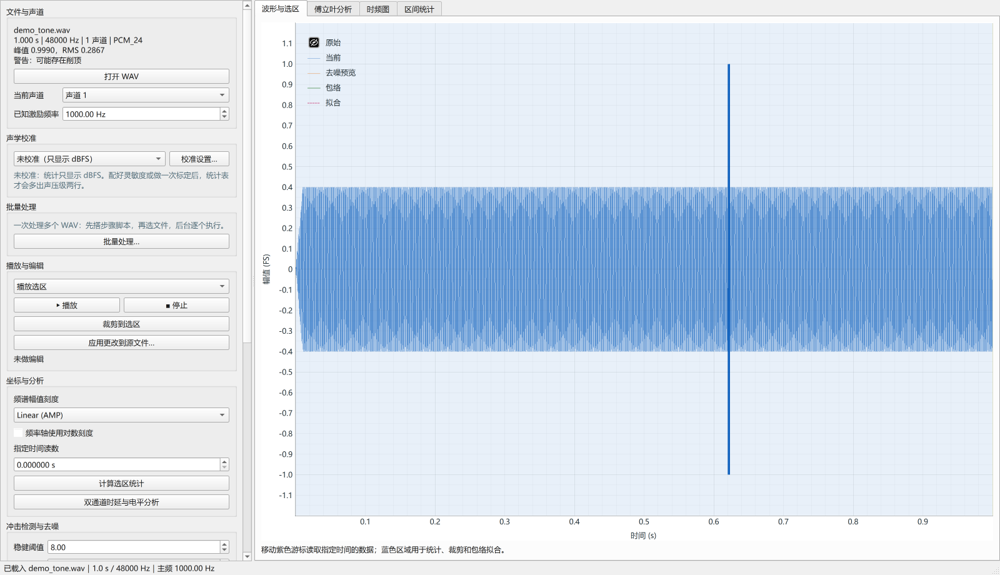
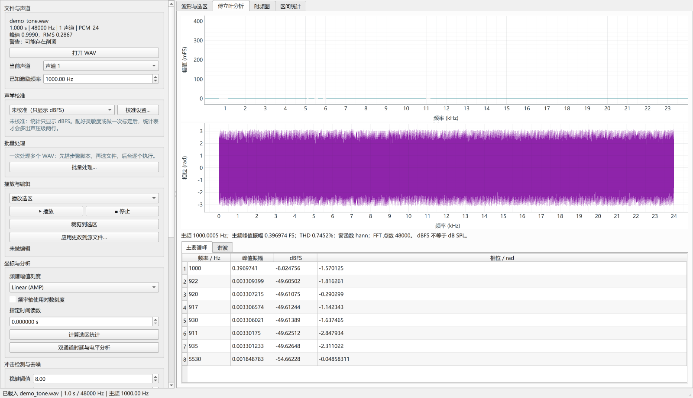

# WAV Analyzer

[English](README.md) · **简体中文**


处理声学测量 WAV 数据的 Windows 桌面程序：读入录音，看波形、频谱与时频图，检测并修复瞬时冲击，拟合包络，算区间统计，导出定宽 TXT、统计 CSV、600 dpi 论文插图和独立 HTML 报告；上百个录音可以配成一条步骤脚本批量跑完。可选接一个大模型助手，用自然语言驱动上面这些工具，但所有改动仍需你确认。

界面（波形与选区 / 傅立叶分析）：




**为什么做它**：声学数据处理通常是「Excel 里抄数 + Origin 里画图」，口径不统一、抄错难发现，报告里的数字和工具里的数字慢慢就对不上了。这个程序把窗函数、归一化、统计分析的定义固定在一处，界面读数、批量结果和导出报告走的是同一条代码路径。

---

## 适用范围

| 场景 | 能得到什么 |
|---|---|
| 稳态单频录音（扬声器、换能器、共振腔响应） | 在波形上画出选区后，算出 RMS 电平、峰值振幅、波峰因数、THD 与谐波表 |
| 扫频与啁啾信号 | 时频图（线性或对数频率轴），分段区间统计 |
| 脉冲响应、敲击测试 | Hilbert 包络拟合（常数／线性／指数），输出方程、R²、RMSE |
| 被碰撞、电磁干扰、削顶污染的录音 | 自动检测瞬时冲击，先预览再提交，插值修复或整段排除 |
| 两次录音的电平比较（有无试样、远近、处理前后） | 双通道模式：互相关时延、两路电平、电平差 |
| 一次实验几十到上百个文件 | 步骤脚本批量流水线，虚化遮罩显示进度，可中途取消 |
| 论文与报告要用的图和表 | 600 dpi 按物理尺寸出图、定宽 TXT、整齐的 CSV、HTML 报告 |

程序跟具体装置无关——只要是装着信号的 WAV，它就能读。

---

## 一、运行方式

### 方式 A：直接用打包好的程序（推荐）

到 [Releases](../../releases) 下载 `WAV_Analyzer_v1.5_win64.zip`，解压后双击 `WAV Analyzer.exe`。无需安装 Python 或任何依赖。

1. 建议单独建一个文件夹存放，例如 `WAV Analyzer`。
2. 首次启动会稍慢（单文件版需把内置组件解压到临时目录），属正常现象。

> 若 Windows 弹出“Windows 已保护你的电脑”提示，选择“更多信息”→“仍要运行”。这是因为程序未购买代码签名证书，并非病毒。可自行用杀毒软件扫描确认。

**命令行可选用法**：把 WAV 文件路径拖到 exe 图标上，或在命令行执行：

```
"WAV Analyzer.exe" "D:\data\sample.wav"
```

程序会直接载入该文件。

### 方式 B：从源码运行

需要 Python 3.11 及以上（开发与测试在 3.13 上完成）。

```bash
git clone <本仓库地址> wav-analyzer
cd wav-analyzer

python -m venv .venv
# Windows
.venv\Scripts\activate
# macOS / Linux
source .venv/bin/activate

pip install -r requirements.txt
python run_app.py            # 启动界面
```

Windows 上也可以直接双击 `run_app.bat`（脚本会优先找 `py -3`，找不到就用 PATH 里的 `python`）。

---

## 二、功能一览

| 类别 | 功能 |
|------|------|
| 数据导入 | 单/双声道 WAV，载入时质量检查（峰值、RMS、削顶警告），原始文件只读 |
| 波形显示 | 波形曲线、时间游标读数、蓝色选区、指定时间数值输入 |
| 频谱分析 | 线性幅值谱 / dBFS、线性 / 对数频率轴、相位谱 |
| 傅立叶分析 | 主频、峰值振幅、主要谱峰、1–8 次谐波、THD |
| 时频图 | STFT 时频分布，用于识别瞬时冲击的宽带特征 |
| 去噪 | 冲击检测与预览、关闭预览、短冲击插值修复、长冲击排除、撤销 |
| 播放与编辑 | 播放选区或全文件、暂停、裁剪到选区、应用更改到源文件（自动备份） |
| 包络 | Hilbert 包络，常数/线性/指数拟合，输出方程、R²、RMSE |
| 区间统计 | 21 项统计量按“中文名 + 数值 + 含义”三列展示，含 RMS、峰值振幅、峰峰值、波峰因数、RMS 电平、THD 等 |
| 声学校准 | 填麦克风灵敏度、前置增益与声卡满幅电压，或用已知声压级标定，得到 dBFS → dB SPL 的偏移量；可存多组配置，统计与导出自动带声压级 |
| 双通道 | 互相关时延、两路电平、电平差、AGC 风险提示 |
| AI 助手 | DeepSeek / Moonshot / OpenAI 厂商预设或任意 OpenAI 兼容接口，白名单工具调用；提问与回答用不同底色气泡区分，回答按 Markdown 渲染；去噪需人工确认 |
| 导出 | 处理后 WAV、分析数据 TXT（定宽对齐，可直接进 Excel / Origin / pandas）、图像 PNG（论文版式或屏幕版式）、统计 CSV、独立 HTML 数据处理报告 |
| 批量处理 | 步骤脚本（去噪／裁剪／包络／统计／五种导出）+ 多选文件，后台逐个执行，虚化遮罩显示导入与处理进度，可中途取消 |
| 界面语言 | 中文或 English，在左侧栏最底部切换；切换后程序自动重启生效。默认中文。导出报告的正文仍为中文，见第七节 |

---

## 三、快速上手

1. 启动程序，点击左侧“打开 WAV”载入录音。
2. 在波形图上拖动蓝色选区，框选稳态区间。
3. 切到“傅立叶分析”页查看主频、谱峰与 THD。
4. 切到“时频图”页观察是否存在短时宽带冲击竖条。
5. 回到“波形与选区”页，点击“检测并预览”：橙色曲线为去噪预览；不满意点“关闭预览”丢弃（不改数据），确认无误后点“应用预览”。
6. 点击“计算选区统计”查看各项指标（表格第三列给出每个统计量的含义）；点击“显示包络并拟合选区”得到包络方程。
7. 需要试听时用“播放与编辑”分组播放选区；只关心某段响应时可先“裁剪到选区”，再重算统计量。
8. 用左侧“导出”区保存处理后的 WAV、分析数据 TXT、图像 PNG、统计 CSV 和 HTML 报告。仅当你确实要覆盖原文件时才用“应用更改到源文件…”，程序会先在同目录生成 `.bak-时间戳.wav` 备份。

详细步骤与原理见随附的《使用手册》。

---

## 四、写报告时怎么导出

**图**：图像导出对话框的尺寸下拉框里选“论文单栏 3.5 × 2.45 in（600 dpi）”或“论文双栏 7.0 × 2.6 in”。论文版式按物理尺寸出图，插进 Word／LaTeX 双栏正文不用再缩放，字号和线宽不会失真；刻度朝内、四边齐全、白底，图例固定在图底一行，不压曲线。单栏且同时勾了包络与拟合时，程序会自动拆成上下两个子图。

**数**：点“导出分析 TXT…”，得到一份纯文本分析报告，分七段（包络方程、傅里叶分析、区间统计、双通道、AI 说明、去噪记录、原坐标），不勾的段落自动跳过并重排编号。全文用定宽空格对齐、没有制表符，除末列外只含 ASCII，因此在任何等宽字体下逐列对齐。文件头附源 WAV 的 MD5 指纹，能核对这份导出对应哪次录音。

坐标表是最长的一段，导出前可选“每秒固定点数”“按步长抽稀”或“全部采样点”；选全量且预计超过 500 万行时程序会再确认一次。

导入方式：`pandas.read_csv(path, sep=r"\s+", comment="#")`；Excel 用“数据 → 分列 → 固定宽度”；Origin 选空格分隔并忽略 `#` 行。

---

## 五、批量处理

一次实验往往几十上百个 WAV。左侧“批量处理…”不是一次性动作，而是一条可以反复运行的**步骤脚本**：

1. 点“＋ 新增步骤”，从下拉里挑功能——单文件能做的处理与导出都在里面（冲击去噪、裁剪、包络拟合、区间统计、双通道、导出 WAV／分析 TXT／图像 PNG／统计 CSV／HTML 报告）；
2. 每个步骤在右侧设参数。当前参数组合下无意义的项会自动置灰（例如“每个文件一个 TXT”时，合并文件名用不上）；
3. 点“选择待处理的文件”多选 WAV——这一步只记路径，不读文件，选几百个也是瞬时的；
4. 设好输出目录（留空＝与源文件同目录），点“开始处理”。

三个值得知道的细节：

- **激励频率可以按文件名取**。区间统计步骤里把“已知激励频率”设成“文件名里的频率”，程序会从 `run_1000Hz_r1.wav` 里抓出 1000 Hz。一批文件跨多个频点时不用逐个改。
- **TXT 与 CSV 都能合并**。选“合并为一个 TXT”时，每个文件的完整报告（含各自的源文件名、路径、MD5 指纹）按处理顺序依次接在同一个文件里，抬头有一份文件清单；CSV 合并则是一个文件一行，直接进 Origin。
- **不会卡死**。处理时主界面会虚化，中间卡片同时显示“正在导入文件（m/n）：文件名”和“正在处理文件（m/n）：文件名”，下面是总进度条；点“取消”会在当前文件处理完后停下，不会留下半个文件。

脚本可以“保存脚本／载入脚本”存成 JSON，下次同样的实验直接载入；关掉窗口也会记住上次的步骤与输出目录。源文件始终只读，导出只写到输出目录。

---

## 六、声学校准

程序默认显示的幅值都是相对数字满幅（FS）归一化的。dBFS **不等于**声压级，程序也不会假装它是——没有标定依据时，它就不输出 dB SPL。

校准就是把电平轴整体平移一个常数：

```
K = 20 · log10( Vfs / (G_lin · S · 20 µPa) )
L_SPL = L_dBFS + K
```

其中 `S` 是麦克风灵敏度（V/Pa），`G_lin` 是前置增益（线性倍数），`Vfs` 是声卡满幅电压（Vrms）。例：灵敏度 10 mV/Pa、增益 0 dB、满幅 1 Vrms，得 `K = +133.98 dB`，即 94 dB SPL 对应 −39.98 dBFS。

对话框里有三种填法：

- **灵敏度 + 增益 + 满幅**：按上面的公式算，适合手上有机型参数的设备。
- **参考声压级（两点标定）**：同一稳定声源下，同时读声级计的 SPL 和程序里的 dBFS，`K = L_ref − L_dBFS`。这条路完全绕开最不可靠的两个参数，手里没有 datasheet、或者不知道声卡满幅电压时反而更稳。
- **未校准**：统计只输出 dBFS。

配置可以命名保存，当前选中的那组会整批用于批量处理。两路电平相减时 `K` 会抵消，所以**电平差**的结果不受校准精度影响；校准真正影响的是**绝对声压级**，以及不同增益批次之间能不能直接比较。

**它不是什么**：这里的校准只是一个常数偏移，不做频率计权（没有 dBA）、不补偿麦克风频响曲线、对 AGC 设备无效。要出计量级声压级，请用声级计并定期送检。

---

## 七、重要提示

1. **原始 WAV 默认只读**：所有编辑只作用于内存中的版本，需另存才会写出新文件。仅当你主动点击“应用更改到源文件…”时才会覆盖原文件，且程序会先在同目录生成 `.bak-时间戳.wav` 备份；写回后撤销栈清空，只能靠该备份还原。
2. **单位区别**：dBFS 是相对数字满幅的电平，不等于声压级 dB SPL。程序默认只输出 dBFS；在左侧“声学校准”里配好灵敏度与前置增益（或用已知声压级标定）之后，统计表、CSV、TXT 与报告才会多出 dB SPL。**带 AGC 的麦克风和已削顶的录音不能这样换算**。
3. **统计量口径**：表格第三列给出每项的定义与量纲。最容易混淆的是峰值振幅 `max|x|`（恒为正）、峰峰值 `max−min`（对称波形约为前者的 2 倍）、RMS（含直流分量）与波峰因数（正弦约 1.414）。CSV 导出仍使用英文键名，便于脚本处理。
4. **去噪需复核**：自动阈值基于合成信号验证，真实数据请先预览、结合波形与时频图人工确认。长冲击会被排除出统计，不会凭空补造信号。
5. **AGC 提醒**：若麦克风使用 MAX9814 等带自动增益控制的模块，增益会随声压变化，两路幅值比不再反映真实的声压比。此时电平差不能直接当作结论，需结合声级计读数或可靠的幅值校准，并在报告中注明 AGC 是否工作。
6. **AI 安全**：AI 只能调用内置白名单工具，不能执行任意代码；去噪必须经你确认，0 段时不会弹窗。上传给 AI 的默认是数值摘要，不是完整 WAV。**API Key 由 Windows 钥匙串（凭据管理器）保存，WAV Analyzer 不会向任何人透露它**：只在与你填写的 Base URL 通信时放进请求头，导出的 TXT/CSV/图片/报告里都没有它。
7. **长音频与数值口径**：程序对超长录音（如 15 分钟、4000 万采样点以上）做了分块优化，计算期间显示“处理中”遮罩并报告进度，界面不会卡死。各类数据的计算口径如下，**请在报告时留意**：
   - **RMS、峰值、峰峰值、标准差等能量统计量**：始终基于所选区间的**全部有效采样点**，精度不受影响。
   - **主频与 THD**：为避免超长音频长时间占用，默认基于居中的约 5.5 秒窗口（262,144 点）计算，频率分辨率约 0.18 Hz @ 48 kHz。界面“傅立叶分析”页会明确标注实际分析的时间范围与点数。做高精度稳态标定时可另行用全量方式复核。
   - **波形显示 / 图像导出 / 时频图**：仅做可视化抽稀，峰谷与读数不变，不参与任何数值计算。
   - **游标包络读数**：使用中心对称窗口消除边缘误差，对稳态信号无系统偏差。
   - **撤销栈**：最多保留 4 级、合计约 1.2 GB，超出后最早的记录自动丢弃。
8. **语言范围**：界面可完整切换中英文；但导出的定宽 TXT 报告、CSV 键名与 HTML 报告正文固定为中文，因为排版按定宽中文列调过。同一次实验建议用同一语言导出，避免一套报告里中英混排。

---

## 八、开发与测试

```bash
pip install -r requirements.txt

pytest -q                    # 全量 150 项
pytest tests/test_batch.py   # 只跑批量流水线
```

界面测试在无显示器的环境里需要 `QT_QPA_PLATFORM=offscreen`（Linux CI 尤其注意）：

```bash
QT_QPA_PLATFORM=offscreen pytest -q
```

改了代码后想看程序自检（不需要人工点界面）：

```bash
# Windows
set WAV_ANALYZER_SELFTEST=demo\demo_tone.wav
python run_app.py
# 结果写在 demo/selftest_result.json
```

自检会跑一遍「载入 WAV → 傅立叶 → 统计 → 论文版式 PNG → TXT 导出 → 批量流水线 → Markdown 渲染 → 密钥库」，输出 `ok: true` 表示核心链路都通。

### 打包成单文件 exe

```bash
pip install pyinstaller
pyinstaller --noconfirm --clean WAV_Analyzer.spec
# 产物：dist/WAV Analyzer.exe
```

`WAV_Analyzer.spec` 里显式收集了 PortAudio、libsndfile 与 keyring 的 Windows 后端——这三处是最容易漏的运行时依赖，缺了会分别报 `PortAudio library not found`、`cannot load library libsndfile` 和 `NoKeyringError`。

### 生成文档配图

```bash
python docs/make_readme_shots.py    # 主界面截图
python docs/make_batch_shots.py     # 批量处理对话框与进度遮罩
python docs/make_ai_shots.py        # AI 设置与会话
python demo/make_demo_tone.py       # 合成演示录音（1 s / 1000 Hz + 一处冲击）
```

抓图必须在原生 Windows 平台下跑（offscreen 平台查不到系统字体，中文会全变成方框），窗口会移到屏幕外再截图。

---

## 九、目录结构

```
run_app.py            程序入口（含无界面自检分支）
WAV_Analyzer.spec     PyInstaller 打包配置
requirements.txt      运行与测试依赖

core/                 纯计算层，不依赖 Qt
  audio_io.py           WAV 读写与质量检查
  spectral.py           傅立叶分析、谱峰、谐波、THD
  denoise.py            冲击检测与修复
  editing.py            裁剪、包络拟合
  statistics.py         21 项区间统计
  calibration.py        声压级换算（灵敏度 / 前置增益 / 两点标定）
  i18n.py               翻译层（以中文原文为键）
  i18n_en.py            英文词条表
  figure_export.py      图像导出（屏幕版式 / 论文版式）
  txt_export.py         定宽 TXT 报告
  report.py             HTML 报告
  batch.py              批量流水线引擎（步骤声明 + 逐文件执行）
app/                  桌面界面层（PySide6）
  main_window.py        主窗口与交互
  chat_view.py          AI 会话气泡视图
  markdown_lite.py      Markdown → Qt 富文本（只用手册里的安全子集）
  batch_dialog.py       批量脚本编辑
  batch_progress.py     批量进度遮罩
  settings_dialog.py    模型设置
  calibration_dialog.py 声学校准设置
  workers.py            后台线程
ai/                   AI 助手
  client.py             OpenAI 兼容接口客户端
  assistant.py          提示词与工具循环
  tools.py              白名单工具
tests/                自动化测试（150 项）
docs/                 使用手册（LaTeX 源 + PDF）与配图脚本
demo/                 合成演示录音与截图；真实测量数据不进仓库
```

`core/` 下的计算模块不依赖 Qt，可以单独 `import` 用在脚本或 Notebook 里；这也是本程序能保证「界面读数 = 批量结果 = 导出报告」的原因——三处调的是同一个函数。

---

## 十、运行环境

- 操作系统：Windows 10 / 11（64 位）
- 内存：建议 8 GB 以上（处理数千万采样点的长录音时更需留意）
- 无需联网即可使用全部手动分析功能；仅 AI 助手需要网络连接
- 界面语言：中文（默认）或 English，切换后程序自动重启生效
- 播放在有可用声卡的机器上工作，无输出设备时其余功能不受影响
- 中文界面依赖系统自带的微软雅黑字体（Windows 10/11 默认具备）

程序不会修改注册表，不会写入系统目录；AI 配置等设置保存在当前用户的应用数据目录，API Key 保存在 Windows 凭据管理器。原始 WAV 默认只读。

---

## 十一、故障排查

- **双击无反应 / 被拦截**：见第一节的 Windows 保护提示处理；或右键以管理员身份运行。
- **中文显示为方块**：确认系统已安装微软雅黑字体（Windows 10/11 默认具备）。
- **大文件界面变灰、遮罩在转**：这是后台计算中的正常状态，等它结束即可，不要反复点击。
- **程序直接退出**：多为内存不足。先裁剪到关注区间再分析，或关闭其它占内存程序。
- **写回源文件提示拒绝访问**：文件被播放器、网盘同步或杀毒软件占用，或属性为只读；关闭占用程序后重试。
- **点击播放没有声音**：无可用输出设备、系统静音或设备被独占。程序会自动按设备采样率重采样播放，失败时会给出提示。
- **AI 连接失败**：401/403 多为 Key 或余额问题，404 多为 Base URL 少了 `/v1` 或模型名写错，429 为限流。优先用厂商预设（选预设只需填 API Key）。
- **AI 请求超时**：默认等待 120 s，推理类模型写长回答时容易触顶；到“模型设置”把超时调到 300 s，或换更快的模型。
- **打开 WAV 失败**：确认文件为标准 PCM 编码的 `.wav`，单声道或双声道；路径不宜过长或含生僻字符。

更完整的错误对照表见手册“常见错误与处理”一章。

---

## 十二、许可与贡献

本项目以 **MIT License** 发布，见 [LICENSE](LICENSE)。可以自由使用、修改、再分发，包括商用；保留版权与许可声明即可。

**欢迎的贡献**：

- 说明某类信号（如扫频、脉冲响应、白噪声激励）的处理口径有问题，附一段可复现的小 WAV；
- 报 bug 时附上「程序版本 + 系统 + 复现步骤 + 自检输出」，比只说“打不开”有用得多；
- 新的统计量或导出格式，请先开 issue 讨论口径，避免同一种量出现两种定义。

**不支持的方向**：把本程序当作声级计或声功率测量仪。如第六节所述，校准只是一个常数偏移——不做频率计权、不补偿麦克风频响、不适用于 AGC 设备。

---

*最初为让一个实验室的测量流程可复现而写，后来发现这套流程对别的声学测量也一样用，就这么长成了通用工具。*
